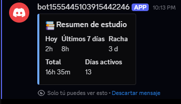

# 🤖 Bot de Discord para estudio

Bot de Discord que lee mi tracker de hábitos de estudio y me contesta con un resumen cuando lo pido.

## Qué hace

- Comando `/resumen`: horas de hoy, de los últimos 7 días, total, días activos y racha.
- Lee el mismo `sesiones.csv` del proyecto [dashboard-estudio](https://github.com/RekiihJoeMama/dashboard-estudio).
- Las respuestas son privadas (solo las ve quien usa el comando).

## Tecnologías

Python · discord.py · pandas · python-dotenv

## Cómo correrlo

1. Creá una aplicación y un bot en el [Portal de Desarrolladores de Discord](https://discord.com/developers/applications) y copiá el token.
2. Invitá el bot a tu servidor con los scopes `bot` y `applications.commands`.
3. Copiá `.env.example` como `.env` y completá tus datos.
4. Instalá y ejecutá:

```powershell
python -m venv .venv
.venv\Scripts\Activate.ps1
pip install -r requirements.txt
python bot.py
```

## Notas

- El token nunca se sube al repo: vive en el archivo `.env`, que está en el `.gitignore`.
- El bot solo responde mientras `bot.py` esté corriendo en mi PC.

## Captura

